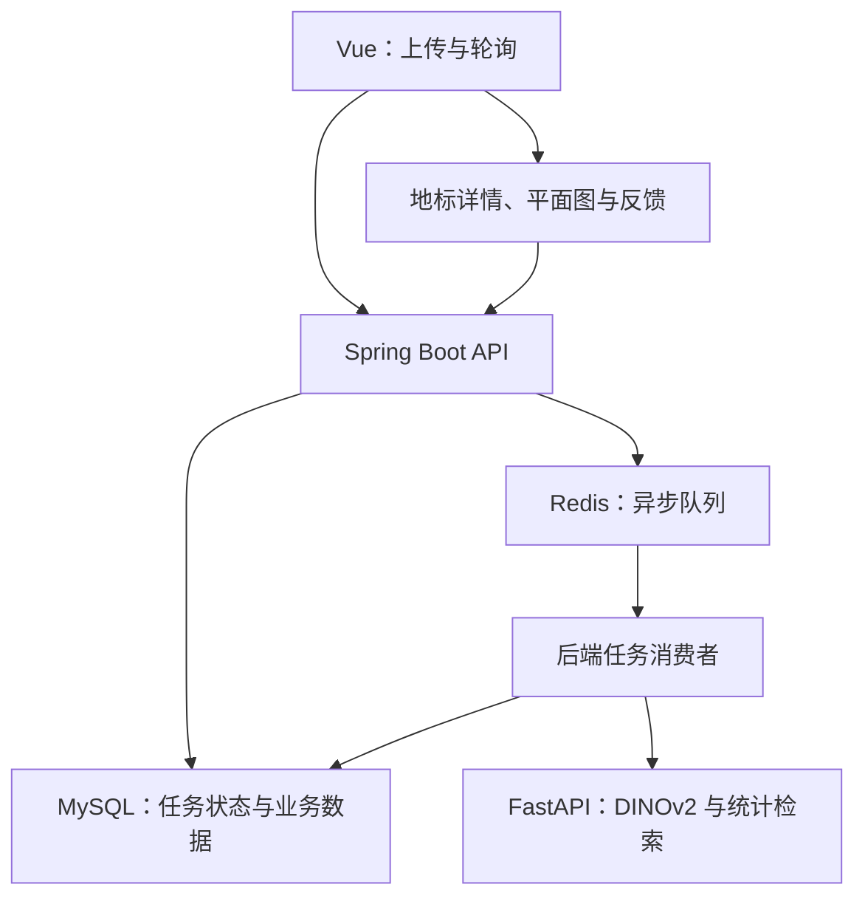

# CampusLens · 校园慧眼

**上传一张校园照片，找到它对应的地标。** CampusLens 面向新生、访客和校内用户，返回 Top-5 候选地标，并提供地标详情、校园平面图位置及反馈纠错入口。

[本地演示与安装](docs/16_development_guide.md#本地演示启动) · [系统与接口](docs/09_interface_runbook.md) · [完整验收记录](docs/15_full_system_acceptance_test.md) · [团队分工](docs/05_module_ownership.md)

## 项目能做什么

- **照片检索**：上传图片后异步处理，展示候选地标及匹配分；低置信度结果有单独状态。
- **地标导览**：查看地标介绍、代表图与静态校园平面图位置。
- **反馈与管理**：提交纠错反馈，维护地标图像库、元数据和检索记录。
- **完整服务链路**：Vue 页面、Spring Boot API、异步任务队列和 Python 算法服务协同工作，支持双算法实例与批量检索。

## 我的工作

**马启凡 · 组长 / M1 图片上传与地标检索主流程**

负责 M1 主流程的跨层开发与联调，贯通图片上传、异步任务提交、状态轮询及结果返回；配合团队完成接口对齐和集成验收。代码按技术栈组织，个人模块可以跨越前端、后端与接口文档目录。

这是五人协作项目：M2 地标库与元数据由叶炳良负责，M3 图像特征与统计检索服务由周子栋负责，M4 结果展示与地图由洪传凯负责，M5 反馈与统计由庄子杰负责。完整模块边界见 [分工文档](docs/05_module_ownership.md)。

## 检索与任务处理

图像特征由 **DINOv2** 提取；每个地标根据样本特征估计均值与协方差，通过**马氏距离**及 sigmoid 经验匹配分排序。该分数不是经过校准的概率。项目使用已有视觉模型完成应用检索，不将其表述为自研基础模型。



浏览器通过 `POST /api/search/upload` 获取 `202 / jobId / jobToken`，再轮询 `GET /api/search/jobs/{jobId}`；后端消费者调用算法的批量检索接口。MySQL 保存权威任务状态，Redis 负责 ready / processing / delayed 调度。

## 技术与源码

| 层次 | 技术 | 入口 |
| --- | --- | --- |
| 页面 | Vue | [frontend](frontend/) |
| 业务与异步处理 | Spring Boot、MySQL、Redis | [backend](backend/) |
| 图像检索 | FastAPI、PyTorch、DINOv2、FAISS | [algorithm](algorithm/) |
| 接口与数据库 | OpenAPI、Flyway | [api](api/) · [database](database/) |
| 启动与验证 | Windows 脚本、Docker Desktop | [scripts](scripts/) |

## 在本地运行

现有脚本主要面向 Windows + Docker Desktop。先按 [安装与运行指南](docs/16_development_guide.md#本地演示启动) 准备 Python / PyTorch 环境、离线 DINOv2 权重和地标样本，生成本地检索索引，再执行：

```powershell
scripts\start.cmd
scripts\verify.cmd
# 结束演示
scripts\stop.cmd
```

前端入口为 `https://localhost:5173`。模型、索引和本地环境配置不包含在 Git 仓库中；启动脚本不会自动下载模型或安装算法依赖。地图提供静态位置展示。

## 进一步阅读

- [项目范围](docs/00_project_overview.md) · [接口契约](api/openapi-campuslens.yaml)
- [运行与并发测试](docs/12_runtime_and_concurrency_test.md) · [GPU 与异步队列测试](docs/13_gpu_async_queue_test.md)
- [完整开发与协作指南](docs/16_development_guide.md)：保留原 README 中的详细安装、环境配置、分支流程和各阶段文档索引。
- [MIT License](LICENSE)
