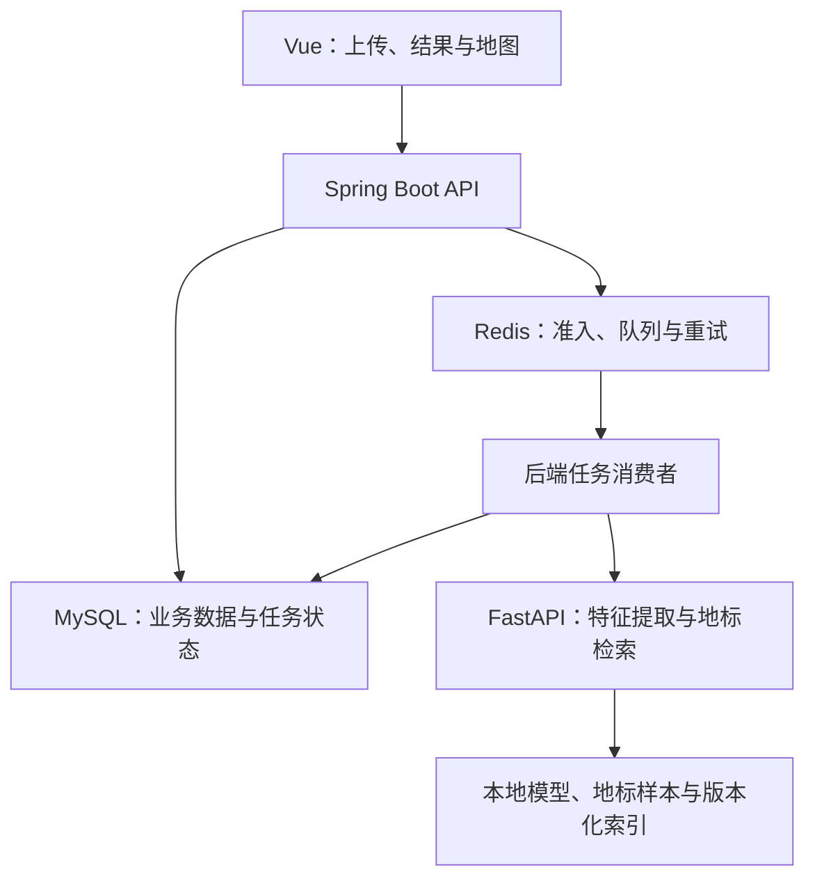

# CampusLens · 校园慧眼

校园地标图像检索与导览系统。上传校园照片后，系统返回 Top-5 候选地标，并提供地标详情、平面图定位、检索历史和反馈纠错。

[快速开始](docs/09_interface_runbook.md) · [系统架构](docs/architecture.md) · [接口文档](docs/02_api_contract.md) · [文档中心](docs/README.md)

## 功能

| 功能 | 说明 |
| --- | --- |
| 图像检索 | 基于 DINOv2 特征、FAISS 召回和马氏距离重排序返回候选地标 |
| 异步处理 | 图片上传后获取任务编号，通过轮询查看处理状态和检索结果 |
| 地图导览 | 展示地标介绍、代表图及校园平面图位置 |
| 反馈纠错 | 收集识别反馈，支持校正样本审核与索引发布 |
| 账号与历史 | 支持登录注册、账号资料、密码找回及检索历史 |
| 校园社区 | 从检索结果发布打卡，支持留言、回复和点赞 |
| 管理功能 | 维护地标资料，处理反馈，查看算法状态并重建索引 |
| 测试时适配 | 可选 SAR 模式，提供独立适配轨道、状态恢复和回退保护 |

## 技术栈

| 层次 | 技术 | 目录 |
| --- | --- | --- |
| 前端 | Vue 3、Vite | [frontend](frontend/) |
| 后端 | Java 17、Spring Boot、Spring JDBC | [backend](backend/) |
| 算法 | FastAPI、PyTorch、DINOv2、FAISS | [algorithm](algorithm/) |
| 数据 | MySQL、Redis、Flyway | [database](database/) |
| 接口 | OpenAPI、REST Client | [api](api/) |
| 运维 | Docker Compose、PowerShell | [scripts](scripts/) |

## 系统结构



MySQL 保存任务权威状态，Redis 负责分发与容量控制。后端消费者调用算法服务，按地标编号补齐展示信息。算法主实例优先处理请求，发生连接失败、超时或服务端错误时转向备用实例。

## 快速开始

先按[运行指南](docs/09_interface_runbook.md)准备 Java、Maven、Node.js、Docker Desktop 和 Python 3.10 环境，并配置：

- 离线 DINOv2 ViT-B/14 权重：`algorithm/models/dinov2_model.pth`。
- 地标样本：`datasets/landmarks/` 下的分类目录。
- 算法环境：`algorithm/.env` 和 `CAMPUSLENS_ALGORITHM_PYTHON`。

在项目根目录执行：

```powershell
scripts\start.cmd
```

浏览器访问 **https://localhost:5173**。首次运行时，在管理员页面发起索引重建，待状态为 `completed` 后上传图片检索。

```powershell
scripts\verify.cmd
scripts\stop.cmd
```

`stop.cmd` 保留数据库数据卷。模型权重、样本原图、索引和本地配置不包含在仓库中。

## 文档

- [项目概览](docs/00_project_overview.md)：功能与应用范围。
- [系统架构](docs/architecture.md)：异步任务、服务调用及索引发布。
- [运行指南](docs/09_interface_runbook.md)：安装、配置与常见问题。
- [接口契约](docs/02_api_contract.md) · [OpenAPI](api/openapi-campuslens.yaml) · [数据字典](docs/03_data_dictionary.md)。
- [检索原理](algorithm/algo.md) · [SAR 适配](algorithm/SAR_IMPLEMENTATION.md) · [数据集规范](docs/04_dataset_rules.md)。
- [测试说明](docs/testing.md) · [开发指南](CONTRIBUTING.md)。

## 说明

匹配分用于候选排序与展示，不表示校准后的识别概率。地图提供静态位置标注。SAR 基于检索分数进行测试时适配，效果需通过独立数据集评估。

## 许可证

本项目使用 [MIT License](LICENSE)。DINOv2 权重及第三方依赖遵循各自的许可证。
