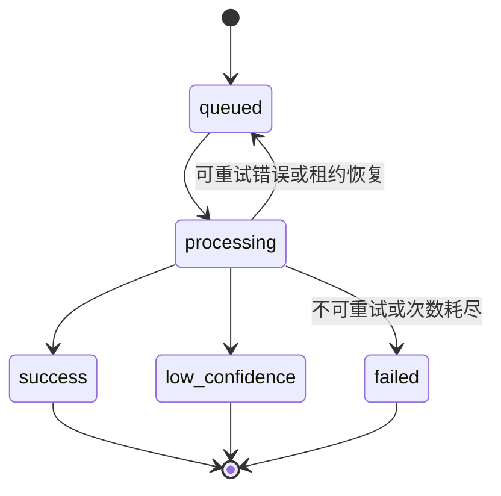

# 系统架构

## 组件

| 组件 | 职责 |
| --- | --- |
| Vue 前端 | 上传、任务轮询、候选展示、地图、社区与管理界面 |
| Spring Boot API | 输入校验、认证、业务数据、任务提交与结果组装 |
| MySQL | 地标、用户、检索任务、反馈、校正样本与索引重建状态 |
| Redis | 任务容量准入、ready 队列、processing 租约与 delayed 重试 |
| 后端任务消费者 | 批次领取、算法调用、结果持久化与任务恢复 |
| FastAPI 算法服务 | DINOv2 特征、地标检索、SAR 及索引构建 |
| 本地存储 | 上传图片、地标样本、模型、索引与 SAR 状态 |

## 异步检索

1. 客户端上传图片，携带所有者身份和 `Idempotency-Key`。
2. 后端校验图片并保存待准入记录。Redis 原子准入成功后，记录进入 `queued`，接口返回 HTTP `202`。
3. 消费者领取任务，写入 `worker_id`、尝试次数及租约，状态变为 `processing`。
4. 后端调用算法服务，按地标编号补齐介绍、封面和地图坐标。
5. 结果持久化，状态进入 `success`、`low_confidence` 或 `failed`。客户端通过轮询读取。

MySQL 是任务状态的权威来源。Redis 不可用时提交返回 `503`；容量达到上限时返回 `429` 和 `Retry-After`。幂等键按所有者划分作用域，同键不同文件返回 `409`。

任务默认最多尝试 3 次，租约为 90 秒。重试时间保存在 MySQL，延迟调度由 Redis 完成。完成、失败和重试更新均校验消费者标识与尝试次数，过期消费者的结果不能覆盖新一轮处理。

## 算法服务与主备

后端优先访问主实例 `8000`，在连接失败、超时或 5xx 时转向备用实例 `8001`。两个实例独立加载模型，共享受版本约束的索引与 SAR 状态。

普通检索可使用受控批次；SAR 请求采用独立任务调度，防止不同用户的图片共享适配梯度。服务通过执行锁限制并行推理，CUDA OOM 时可拆为单图重试。

## 检索与适配

DINOv2 提取归一化图像特征。FAISS 使用地标中心向量召回候选，候选按马氏距离和经验匹配分重排序。算法详见[检索原理](../algorithm/algo.md)。

基准轨道保持模型不变；SAR 轨道通过可靠样本筛选与 SAM 更新归一化层参数，并使用 EMA、锚点保持率和特征漂移控制回退。SAR 状态与基础模型、活动索引版本绑定。详见[SAR 说明](../algorithm/SAR_IMPLEMENTATION.md)。

## 反馈与索引发布

用户反馈先进入待处理状态。管理员采纳后，后端从受控上传目录复制图片，生成待发布校正样本。索引重建使用候选模型和正式、待发布样本构建完整索引；验证通过后原子切换活动版本。

构建期间的在线请求继续读取旧版本。构建失败时保留旧版本，成功发布后更新校正样本的发布状态。普通用户不能直接触发模型或索引发布。

## 存储与访问

- 登录用户通过 Bearer token 访问个人与管理接口；管理接口额外校验角色。
- 游客由服务端分配持久化编号，游客任务通过任务令牌查询。
- 检索、反馈和社区操作校验所有权；社区照片公开由发布者主动选择。
- 运行数据位于本地数据库、上传目录和算法数据目录，版本控制仅保存源码、配置示例与迁移脚本。

接口与字段分别见[接口契约](02_api_contract.md)和[数据字典](03_data_dictionary.md)。
